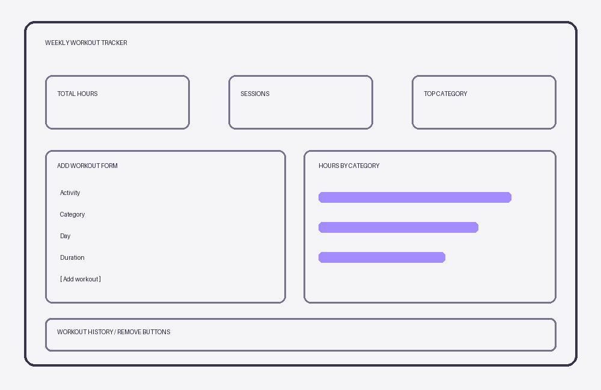

# Weekly Workout Tracker

**Author(s):** Jeffrey Jones

## Project plan

### Project idea
A browser-based weekly exercise tracker for students and athletes who want to log training time and compare activity categories.

### Planned features
- Add workout sessions with an activity description, category, day, and hours.
- Validate entries and display field-specific errors.
- Calculate total hours, session count, and hours by category.
- Show a visual category breakdown and remove entries.
- Save sessions in browser localStorage.

### Wireframe / sketch

## Web links
- **Published application:** TODO: Insert GitHub Pages URL
- 
- **GitHub repository:** TODO: https://github.com/JJisbased13/laurea-web-development-1/tree/main
- 
- **Project video presentation:** https://teams.microsoft.com/l/meetingrecap?driveId=b%21G-Pu8uCxqkuvPvVzyUBlpUaESczOfSNNmg_BLe48m9XBH3YwbizkT519jIQ0FVG_&driveItemId=01F342OARV2EHVL3UP6NDYXUBQ2SQKWXSK&sitePath=https%3A%2F%2Flaureauas-my.sharepoint.com%2F%3Av%3A%2Fg%2Fpersonal%2Fjej00070_laurea_fi%2FIQA10Q9V7o_zR4vQMNSgq15KAS2yhIlBG9Jo80wqMXpEZ6I&fileUrl=https%3A%2F%2Flaureauas-my.sharepoint.com%2F%3Av%3A%2Fg%2Fpersonal%2Fjej00070_laurea_fi%2FIQA10Q9V7o_zR4vQMNSgq15KAS2yhIlBG9Jo80wqMXpEZ6I&threadId=19%3Ameeting_NWYyNWViMDItYjlkZi00NjE5LThlYzUtYzA1Y2EyMDVlMWUy%40thread.v2&organizerId=1caa9153-c0bc-40e1-af99-9fe1dcb93cd0&tenantId=f0b9e9d7-8d66-4b16-9c1c-6b07c4796280&callId=0f0d3318-384f-478f-9dbf-4ee5ee28e2b5&threadType=Meeting&meetingType=MeetNow&subType=RecapSharingLink_RecapChiclet&recapType=RecordingAndTranscript

## About the application
**Weekly Workout Tracker** is a single-page app that records exercise sessions for a weekly log. Users enter a description, category, weekday, and duration. A summary and chart update immediately. The user can remove individual entries or clear all data.

## Technologies
- HTML – semantic page structure and input form
- CSS – responsive layout, visual styling, and category bars
- JavaScript – form validation, DOM creation, event listeners, and calculations
- localStorage – persistence across browser refreshes

## How to use the application
1. Open the published website.
2. Enter a workout name, choose its category and day, and enter hours (0.25–24).
3. Click **Add workout**. Review the summary and category chart.
4. Remove a workout with its **Remove** button, or use **Clear all**.
5. Refresh the browser to verify entries are saved.

## Running the application locally
1. Download or clone this repository.
2. Open the project folder.
3. Open `index.html` in a web browser.

## Screenshots
TODO: Add a screenshot of the running application at 

## Known issues / limitations
- The app uses a manually maintained weekly log, rather than calendar-dated records. To begin a new week, clear the old entries.
- Data is saved only in the current browser and is not synchronized across devices.

## Division of work
Individual project.

## Self-assessment and learning reflection
**To complete after testing and recording the demo:**
- What did I succeed in? Understanding the concept of DOM and input validation.
- 
- What was challenging? The styling was the hadest part for me. wanted something that was easy on the eyes and not look clunky.
- 
- What would I improve if I had more time? I would make the tracker able to track data by month and year.
- 
- What did I learn about HTML, CSS, JavaScript and DOM scripting? I learned how to use HTML to structure webpages, CSS to style them, and JavaScript to add functionality and interactivity. I also learned how DOM scripting allows JavaScript to interact with HTML elements, respond to user actions, and update webpage content dynamically.

- 
- What remained unclear or what would I like to learn more about?  would like to learn more about making websites look modern, visually appealing, and fluid. Specifically, I want to improve my CSS skills to create smoother animations, transitions, and responsive layouts that make websites feel more professional and interactive.
- 
- My self-assessed project grade: 8

## Sources and acknowledgements
- AI tool used: ChatGPT (OpenAI).
  - How the tool was used: Assisted in planning the application, drafting the initial HTML/CSS/. 

## License
MIT License (add a LICENSE file to the repository if choosing this license).
